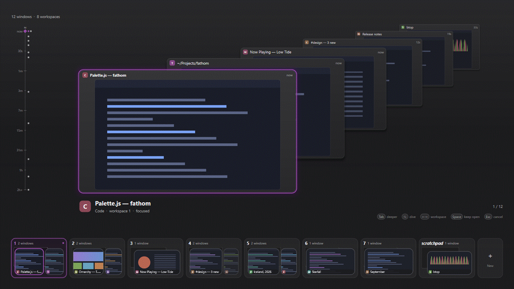
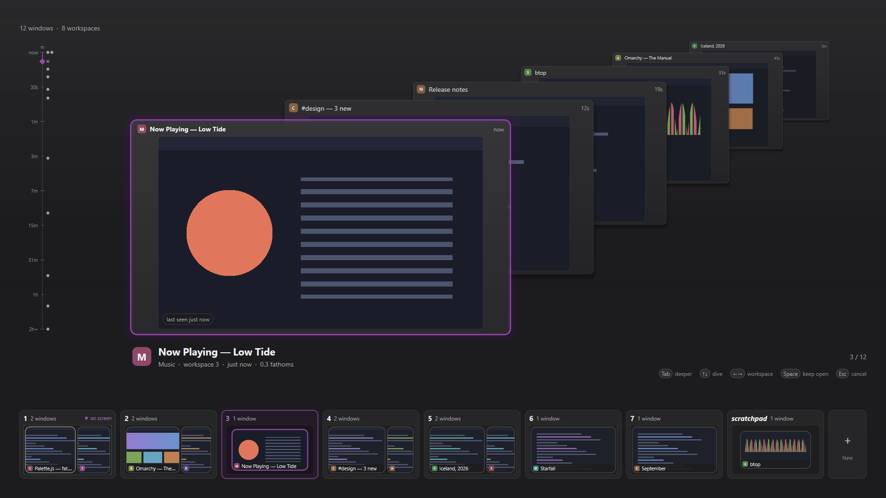
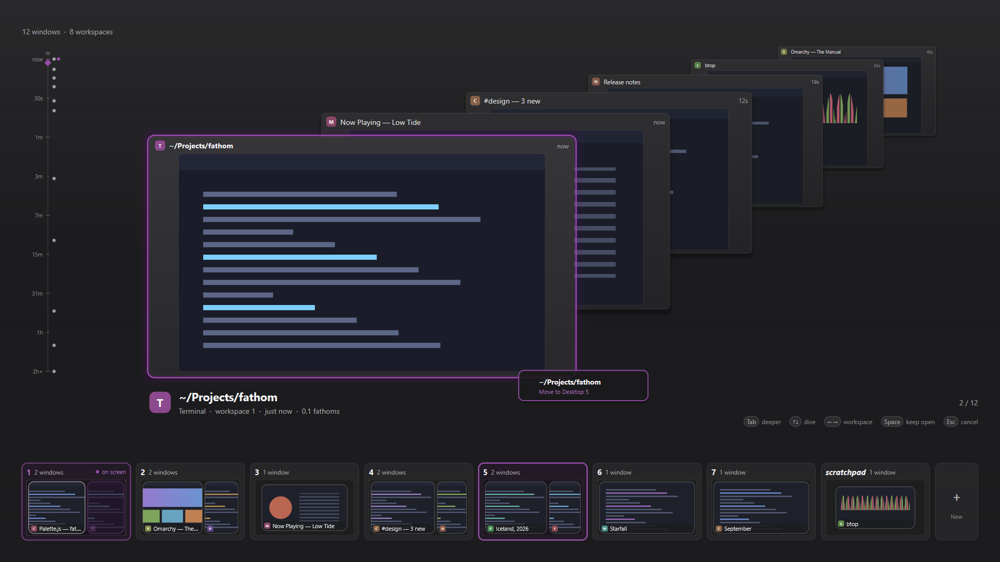
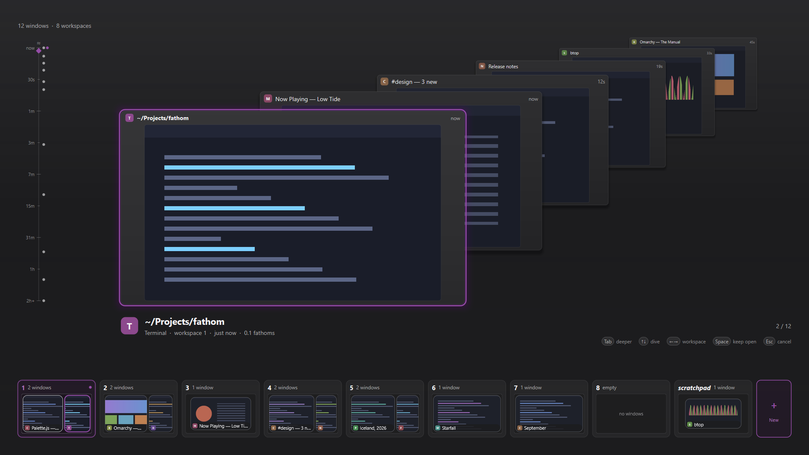

# Winscroller Alt+Tab

A fast, depth-based `Alt+Tab` window switcher and Virtual Desktop workspace organizer for Windows 10 & 11 power users—written in pure Rust with Direct3D 11 and Direct2D, visually inspired by [mtolhuys/fathom](https://github.com/mtolhuys/fathom).

`Windows 10 / 11 (x64)` · `Pure Rust` · `Direct3D 11 + Direct2D` · `MIT License`

<p align="center">
  
</p>

---

## What is Winscroller Alt+Tab?

Windows' default `Alt+Tab` shows a flat, unordered grid that loses your window context. **Winscroller Alt+Tab** arranges your active windows back into a 3D z-depth plane based on focus recency, provides an interactive time-travel gauge on the left, and mirrors your Windows Virtual Desktops across the bottom.

You can create new Virtual Desktops on the fly with **`+ New desktop`**, switch between them, and **drag and drop** windows across desktops with hardware-accelerated Direct2D responsiveness.

---

## Feature Tour & Screenshots

### 1. The Deep — Spatial-Temporal Recency Stack
Windows are laid out along a logarithmic z-axis based on when you last interacted with them (`depth = log2(1 + seconds / 30)`, clamped to 8 fathoms). Smooth `220ms` `OutCubic` camera gliding and progressive depth fog give you an instant spatial sense of time.

<p align="center">
  
</p>

### 2. The Sounding Line — Interactive Time Gauge
The vertical gauge along the left rail is marked from `now` (`≈`) through `30s`, `1m`, `3m`, `7m`, `15m`, `31m`, `1h`, and `2h+`. Every open window appears as a dot (solid when tracked live, hollow when estimated at startup) with an animated depth diamond. Click or drag anywhere along the gauge to scrub through history.

### 3. Drag-and-Drop Across Virtual Desktops
Organize your workspace visually. Click and drag any window card in The Deep or any minimap tile and drop it onto another Virtual Desktop card. Cross-process windows move natively on Windows 11 via internal shell interfaces (`IApplicationViewCollection` + `IVirtualDesktopManagerInternal`).

<p align="center">
  
</p>

### 4. On-Page Virtual Desktop Creation
Create new workspaces without breaking your flow. Click the **`+ New desktop`** card on the bottom map to spawn a new Windows Virtual Desktop right on the page without dismissing the overlay.

<p align="center">
  
</p>

### 5. Instant Search & Live Filtering
Start typing anytime to narrow down your open windows. The overlay filters live across window titles, process names, executable paths, and Virtual Desktop labels.

<p align="center">
  
</p>

### 6. Adaptive Windows Light/Dark Theme
Winscroller Alt+Tab automatically queries Windows (`AppsUseLightTheme` and `DWM\AccentColor`) to match your system theme with WCAG 2 contrast-guaranteed text, cards, and markers.

### 7. Zero-Flash Quick Switching (90ms Grace Window)
Tapping `Alt+Tab` quickly switches back to your previous window immediately with **zero visual flash**. The full overlay only fades in if you keep `Alt` held past 90ms.

---

## Installation & Quickstart Guide (Build from GitHub Clone)

Follow these simple steps to download, compile, and run Winscroller Alt+Tab from source on any Windows 10 or 11 machine.

> For an expanded step-by-step walkthrough with screenshots and common questions, see the **[INSTALL.md](INSTALL.md)** guide.

### Step 1: Install Git & Rust (One-Time Setup)

Open **PowerShell** (press `Win + X`, select **Terminal** or **PowerShell**) and install Git and Rust using Windows Package Manager:

```powershell
winget install --id Git.Git -e --source winget
winget install --id Rustlang.Rustup -e --source winget
```

*(Close and reopen PowerShell after the installer finishes so environment variables refresh).*

*Alternatively, download installers manually from [git-scm.com](https://git-scm.com/) and [rustup.rs](https://rustup.rs/).*

### Step 2: Clone the Repository

Clone the project to your computer and enter the directory:

```powershell
git clone https://github.com/fruitsaladwindowsai-zammy/Alt-Tab.git
cd Alt-Tab
```

### Step 3: Build the Optimized Release Binary

Compile the release binary:

```powershell
cargo build --release
```

Cargo will download dependencies and compile the Direct3D 11 engine (~30–60 seconds). The final standalone executable will be created at:
```text
target\release\winscroller-alt-tab.exe
```

### Step 4: Run Winscroller Alt+Tab

#### Quick Safe Preview (Interactive Demo):
```powershell
.\target\release\winscroller-alt-tab.exe --demo
```

#### Run in Background as your Live Switcher:
```powershell
.\target\release\winscroller-alt-tab.exe
```

- When prompted for **UAC Elevation**, click **Yes**. (Windows UIPI requires elevation so low-level keyboard hooks and live window previews work over Administrator windows like Task Manager).
- To run without elevation, add `--no-elevate`:
  ```powershell
  .\target\release\winscroller-alt-tab.exe --no-elevate
  ```

### Step 5: Enable "Start with Windows" (Autostart)
1. Right-click the **Winscroller Alt+Tab** icon in your system tray (bottom-right near the clock).
2. Click **Start with Windows** (a checkmark will appear).

### Step 6: Updating in the Future
To get the latest updates anytime:
```powershell
cd Alt-Tab
git pull origin main
cargo build --release
.\target\release\winscroller-alt-tab.exe --replace
```

---

## Alternative Install Methods

### Option A: Prebuilt Binary (No Compiler Needed)
1. Go to the [Releases](https://github.com/fruitsaladwindowsai-zammy/Alt-Tab/releases) page.
2. Download `winscroller-alt-tab.exe`.
3. Double-click to launch, and check **Start with Windows** from the tray icon.

### Option B: NuGet Tool Package
For CI/CD and enterprise feeds:
```powershell
# Create target\winscroller-alt-tab.0.1.0.nupkg
.\package-nuget.ps1

# Install from NuGet feed
nuget install winscroller-alt-tab -OutputDirectory tools
```

---

## Run Modes & CLI Flags

| Command | Purpose |
| --- | --- |
| `winscroller-alt-tab.exe` | Run in background with system tray icon and global `Alt+Tab` hook |
| `winscroller-alt-tab.exe --no-elevate` | Run without requesting UAC Administrator privileges |
| `winscroller-alt-tab.exe --replace` | Terminate any currently running instance and start fresh |
| `winscroller-alt-tab.exe --browse` | Open directly into pinned Browse mode (or wake running instance) |
| `winscroller-alt-tab.exe --demo` | Launch interactive demo window with 12 mock windows across 8 desktops |
| `winscroller-alt-tab.exe --render-demo preview.png` | Render a 1920x1080 offscreen demo PNG and exit |
| `winscroller-alt-tab.exe --render-gallery docs` | Render all high-resolution feature screenshots and animation frames |

---

## Keybindings & Controls

See **[KEYBINDINGS.md](KEYBINDINGS.md)** for the complete interactive reference and edge cases.

| Input | Action |
| --- | --- |
| `Alt + Tab` / `Alt + Shift + Tab` | Open in Hold mode on previous / oldest window; step deeper / shallower while holding `Alt` |
| Release `Alt` *(Hold mode)* | Focus selected window and close (switches immediately if released `< 90ms`) |
| `Alt + \`` or `Ctrl + Alt + Space` | Toggle Browse mode (stays open without holding `Alt`) |
| `Space` *(Hold mode, empty filter)* | Pin Hold mode into Browse mode so releasing `Alt` keeps the overlay open |
| `Tab` / `Shift + Tab` | Step deeper / shallower (wraps) |
| `↓` / `↑` or Vertical Wheel | Step deeper / shallower |
| `→` / `←` or Horizontal Wheel | Jump to most recent window on next / previous Virtual Desktop |
| `PgDn` / `PgUp` | Step 5 windows deeper / shallower |
| `Home` / `End` | Jump to frontmost / oldest window |
| `1`–`9` *(when filter empty)* | Jump to most recent window on Virtual Desktop `1`–`9` |
| Type letters / numbers | Filter windows live by title, app name, app ID, or workspace |
| `Backspace` / `Ctrl + Backspace` | Delete last filter character / clear filter |
| `Enter` | Focus selected window |
| `Esc` | Clear active filter, or cancel and close without switching |
| **Click** window card / tile | Focus that window |
| **Click** empty workspace card | Switch directly to that Windows Virtual Desktop |
| **Click** `+ New` / `+ New desktop` | Create a new Virtual Desktop directly from the overlay |
| **Drag & Drop** window card/tile | Move window to another Virtual Desktop card or onto `+ New desktop` |
| **Click / Drag** Sounding Line | Scrub directly to any window along the time gauge |

---

## Configuration

Settings live at `%APPDATA%\winscroller-alt-tab\config.toml` (or click **Open config.toml** from the system tray menu). Changes reload live the next time the overlay opens:

```toml
[winscroller]
corner-radius = 10
border-width = 1.0
font-family = "Segoe UI"
font-scale = 1.0
show-scratchpads = true
open-on-single = false

# Optional custom hex color overrides (#rgb, #rrggbb, or #aarrggbb):
# foreground = "#f3f3f5"
# background = "#1c1c1e"
# accent = "#60cdff"
# urgent = "#ff6b6b"
```

---

## Documentation

- **[INSTALL.md](INSTALL.md)** — Exhaustive step-by-step installation walkthrough for beginners
- **[KEYBINDINGS.md](KEYBINDINGS.md)** — Complete keyboard, mouse, filter, and drag-and-drop reference
- **[RELEASE_NOTES.md](RELEASE_NOTES.md)** — Release Notes (`v0.1.0`)
- **[CHANGELOG.md](CHANGELOG.md)** — Version history
- **[CONTRIBUTING.md](CONTRIBUTING.md)** — Architecture layout, building, and testing
- **[LICENSE](LICENSE)** — MIT License
