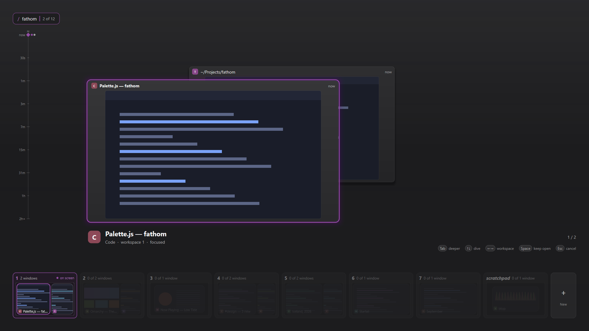
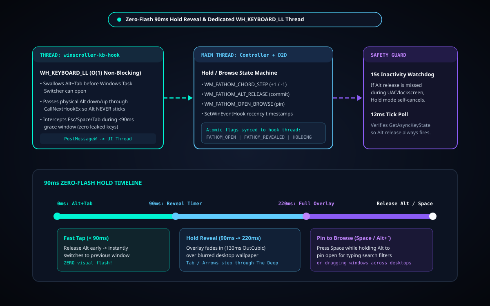
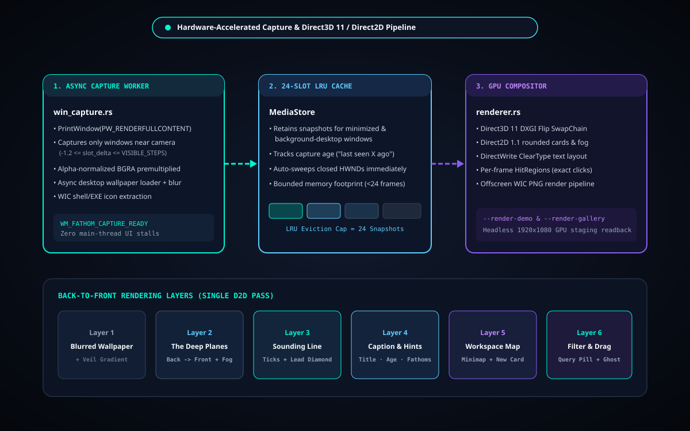
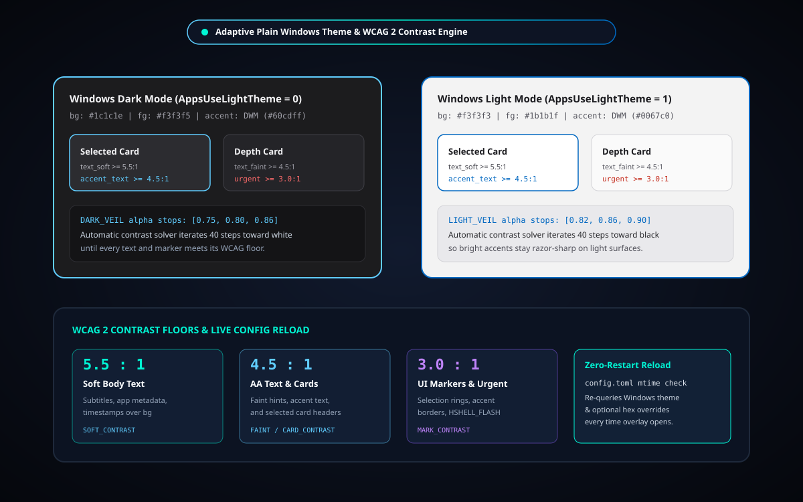

# Winscroller Alt+Tab

**A hardware-accelerated, depth-based `Alt+Tab` window switcher and Virtual Desktop workspace organizer for Windows 10/11 — written in pure Rust with Direct3D 11, Direct2D, DirectWrite, and WIC, visually inspired by [mtolhuys/fathom](https://github.com/mtolhuys/fathom).**


[](https://github.com/fruitsaladwindowsai-zammy/Alt-Tab/actions/workflows/ci.yml)
[](https://fruitsaladwindowsai-zammy.github.io/Alt-Tab/)


> 📖 **Official Documentation & Guides**:  
> Read the complete interactive mdBook manual, keybinding reference, Virtual Desktop internals, and architecture deep dives:  
> [**fruitsaladwindowsai-zammy.github.io/Alt-Tab**](https://fruitsaladwindowsai-zammy.github.io/Alt-Tab/)

```text
  ┌───────────────────────── Winscroller Alt+Tab Overlay ─────────────────────────┐
  │  [/ type to filter]                                                           │
  │                                                                               │
  │  now ≈ ••   ┌───────────────────────────┐   ┌───────────────────┐             │
  │  30s   •    │  Active Window (0.0 fth)  │   │  Previous (1.3)   │  [Depth]    │
  │  1m    •    │  Direct2D Live Preview    │   └───────────────────┘             │
  │  7m    ◦    └───────────────────────────┘        ◄── d = log2(1 + t/30)       │
  │  2h+   ◦      [Title · App · just now · 0.0 fathoms]                          │
  │                                                                               │
  │  ┌──────────────┐ ┌──────────────┐ ┌──────────────┐ ┌──────────────────────┐  │
  │  │ 1 Code • on  │ │ 2 Research   │ │ 3 Empty      │ │    + New desktop     │  │
  │  └──────────────┘ └──────────────┘ └──────────────┘ └──────────────────────┘  │
  └───────────────────────────────────────────────────────────────────────────────┘
```

---

## Live Demo & Visual Overview

### 🎬 Animated Walkthrough

<p align="center">
  
</p>

*Full interactive workflow: depth stepping along The Deep, Sounding Line time scrubbing, live search filtering, cross-desktop drag-and-drop, and on-page `+ New desktop` creation.*

---

### 📸 Screenshots Gallery

| The Deep — Spatial-Temporal Recency Stack | Instant Live Search & Filtering |
|:---:|:---:|
|  |  |
| *Logarithmic depth curve (`0–8 fathoms`), progressive depth fog & `220ms OutCubic` gliding* | *Filter across titles, apps, process IDs, and desktop names with live minimap highlights* |

| Drag-and-Drop Across Virtual Desktops | On-Page `+ New desktop` Creation |
|:---:|:---:|
|  |  |
| *Move arbitrary cross-process windows between desktops via Windows 11 shell COM interfaces* | *Spawn new Windows Virtual Desktops right on the page without dismissing the overlay* |

---

### 📐 Architectural Concepts & System Mechanics

| The Deep — Logarithmic Recency Stack | The Sounding Line — Interactive Time Gauge |
|:---:|:---:|
|  |  |
| *`depth = log2(1 + seconds / 30)` up to 8 fathoms with exponential fog* | *Left-rail scrub bar (`now` to `2h+`) with live vs startup-estimated dots* |

| Workspace Map & Drag-and-Drop COM Engine | Zero-Flash `90ms` Hold & Hook Pipeline |
|:---:|:---:|
|  |  |
| *`IApplicationViewCollection` + `IVirtualDesktopManagerInternal` moves* | *Dedicated `WH_KEYBOARD_LL` thread, `90ms` grace window & `15s` watchdog* |

| Async `PrintWindow` & D3D11/Direct2D Pipeline | Adaptive Windows Theme & WCAG 2 Contrast |
|:---:|:---:|
|  |  |
| *24-slot LRU snapshot cache, blurred wallpaper & headless WIC export* | *Auto-follows `AppsUseLightTheme` & `DWM\AccentColor` with verified contrast* |

---

## Installation Guide (Step-by-Step)

> For an expanded beginner walkthrough with extra FAQs, see **[INSTALL.md](INSTALL.md)**.

### 1. Prerequisites (Clean Windows 10 / 11 Machine)
Windows does **not** include Git or Rust by default. Open an **Administrator PowerShell** prompt (`Win + X` → **Terminal (Admin)**) and run:

```powershell
# 1. Install Git for Windows (Enables 'git clone' in PowerShell)
winget install --id Git.Git --accept-package-agreements --accept-source-agreements

# 2. Install Rust toolchain (Rustup)
winget install --id Rustlang.Rustup --accept-package-agreements --accept-source-agreements

# 3. (Optional, if using MSVC instead of GNU) Install MSVC C++ Build Tools
winget install --id Microsoft.VisualStudio.2022.BuildTools --override "--wait --quiet --add Microsoft.VisualStudio.Workload.VCTools --includeRecommended"
```

> [!IMPORTANT]
> **Restart Your Terminal**: After running the `winget` commands above, **close and reopen** your PowerShell window so `git`, `cargo`, and `rustc` are loaded into your `PATH`.
>
> *(Tip: No Visual Studio needed if you prefer the standalone MinGW toolchain: `rustup default stable-x86_64-pc-windows-gnu`.)*

### 2. Download the Source Code

#### Option A: Clone with Git (Recommended)
```powershell
git clone https://github.com/fruitsaladwindowsai-zammy/Alt-Tab.git
cd Alt-Tab
```

*Or clone using GitHub CLI or SSH:*
```powershell
# Using GitHub CLI:
gh repo clone fruitsaladwindowsai-zammy/Alt-Tab
cd Alt-Tab

# Or using SSH:
git clone git@github.com:fruitsaladwindowsai-zammy/Alt-Tab.git
cd Alt-Tab
```

#### Option B: Download ZIP (No Git Required)
```powershell
Invoke-WebRequest -Uri "https://github.com/fruitsaladwindowsai-zammy/Alt-Tab/archive/refs/heads/main.zip" -OutFile "$HOME\Downloads\winscroller-alt-tab.zip"
Expand-Archive -Path "$HOME\Downloads\winscroller-alt-tab.zip" -DestinationPath "$HOME\Projects"
cd "$HOME\Projects\Alt-Tab-main"
```

### 3. Build & Initialize
```powershell
# Compile with LTO + release optimizations (~30–60s first build)
cargo build --release

# Create default configuration at %APPDATA%\winscroller-alt-tab\config.toml
.\target\release\winscroller-alt-tab.exe --init-config

# Validate configuration syntax
.\target\release\winscroller-alt-tab.exe --validate
```

### 4. Run Winscroller Alt+Tab

```powershell
# Safe interactive preview (12 mock windows across 8 desktops, zero hooks):
.\target\release\winscroller-alt-tab.exe --demo

# Run in background as your live Alt+Tab switcher:
.\target\release\winscroller-alt-tab.exe
```

> [!NOTE]
> **Automatic Administrator Elevation**:  
> When launched, Winscroller Alt+Tab requests Administrator elevation via Windows UAC so Windows UIPI permits its low-level `WH_KEYBOARD_LL` hook and `PrintWindow` preview captures even while elevated windows (Task Manager, Admin PowerShell) have focus. To run without elevation, pass `--no-elevate`.

### 5. Enable Autostart ("Start with Windows")
1. Right-click the **Winscroller Alt+Tab** icon in your Windows system tray (bottom-right near the clock).
2. Click **Start with Windows** (a checkmark will appear; toggles `HKCU\...\Run\WinscrollerAltTab`).

### Alternative Install Methods
- **Prebuilt Release Binary:** Download `winscroller-alt-tab.exe` or the `.zip` archive from the [GitHub Releases](https://github.com/fruitsaladwindowsai-zammy/Alt-Tab/releases) page.
- **NuGet Tool Package:** Run `.\package-nuget.ps1` locally or install via `nuget install winscroller-alt-tab -OutputDirectory tools`.

---

## Updating Winscroller Alt+Tab

Windows locks a running `.exe` while active. Follow these steps for a clean update:

```powershell
# 1. Gracefully exit any running instance
.\target\release\winscroller-alt-tab.exe --quit

# 2. Pull the latest changes
git pull origin main

# 3. Rebuild the optimized release binary (and optionally run unit tests)
cargo build --release
cargo test

# 4. Launch the freshly built switcher
.\target\release\winscroller-alt-tab.exe --replace
```

---

## Why Winscroller Alt+Tab?

- **The Deep (Spatial-Temporal Recency Stack)** — Replaces flat grids with a logarithmic z-depth plane (`depth = log2(1 + seconds / 30)` up to 8 fathoms), smooth `220ms OutCubic` camera gliding, and exponential depth fog.
- **The Sounding Line (Interactive Time Gauge)** — Left-rail time gauge (`now` through `2h+`) plots every window as a clickable/draggable dot (solid when tracked live, hollow when estimated at startup) with an animated lead diamond.
- **Workspace Map, Drag-and-Drop & `+ New desktop`** — Mirrors all Windows Virtual Desktops across the bottom with real minimap geometry, lets you spawn new Virtual Desktops right on the page, and moves arbitrary cross-process windows across desktops via `IApplicationViewCollection` + `IVirtualDesktopManagerInternal`.
- **Zero-Flash `90ms` Hold Reveal** — Rapid `Alt+Tab` taps switch instantly with zero visual flash; holding `Alt` past 90ms fades in the overlay, and pressing `Space` pins it into Browse mode.
- **Instant Live Search** — Start typing anytime to filter across window titles, app names, executable IDs, and Virtual Desktop labels with synchronized minimap highlights.
- **Adaptive Plain Windows Theme** — Automatically follows Windows Light/Dark mode (`AppsUseLightTheme`) and `DWM\AccentColor` with WCAG 2 contrast verification (`5.5:1` / `4.5:1` / `3.0:1`) and zero-restart TOML reload.
- **Single Pure-Rust Native Binary** — Direct3D 11 + Direct2D + DirectWrite + WIC + dedicated `WH_KEYBOARD_LL` hook thread with zero external runtime dependencies.

### 🏆 Feature Comparison: Winscroller Alt+Tab vs. Other Windows Switchers

| Feature | Winscroller Alt+Tab | Windows 11 Alt+Tab | Windows 11 Task View | Alt-Tab Terminator | Switcheroo |
| :--- | :---: | :---: | :---: | :---: | :---: |
| **Temporal Depth Stack** | **Logarithmic Fathoms + Fog** | ❌ Flat MRU grid | ❌ Flat grid | ❌ Vertical list | ❌ Vertical list |
| **Interactive Time Gauge** | **Sounding Line (`now`–`2h+`)** | ❌ None | ❌ None | ❌ None | ❌ None |
| **Virtual Desktop Map** | **Live Minimap + Click/Switch** | ❌ None | Bottom bar only | ❌ None | ❌ None |
| **Drag Windows Across Desktops** | **Direct Card/Tile Drag + `+ New`** | ❌ None | Basic drag | ❌ None | ❌ None |
| **Zero-Flash Quick Switch** | **`90ms` Grace Window** | Instant flash | Full animation | Configurable | ❌ Overlay only |
| **Live Multi-Field Filter** | **Title, App, Exe & Desktop** | ❌ None | ❌ None | Basic filter | Title/Process |
| **Adaptive Windows Theme** | **Auto Light/Dark + WCAG 2** | Native OS | Native OS | Custom themes | Basic |
| **Admin App Support (UIPI)** | **Automatic UAC Elevation** | Native OS | Native OS | Optional | Manual |
| **Runtime & Footprint** | **Pure Rust D3D11/D2D (~700 KB)** | OS shell | OS shell | Proprietary C++ | .NET Framework |

---

## Essential Keybindings

| Shortcut | Action |
| :--- | :--- |
| `Alt + Tab` / `Alt + Shift + Tab` | Open in Hold mode on previous / oldest window; step deeper / shallower while holding `Alt` |
| Release `Alt` *(Hold mode)* | Focus selected window and close (zero flash if released `< 90ms`) |
| `Alt + \`` or `Ctrl + Alt + Space` | Toggle pinned **Browse** mode (stays open without holding `Alt`) |
| `Space` *(Hold mode, empty filter)* | Pin Hold mode into Browse mode |
| `Tab` / `Shift + Tab` / `↓` / `↑` | Step deeper / shallower (also Vertical Mouse Wheel) |
| `→` / `←` or Horizontal Wheel | Jump to next / previous Virtual Desktop |
| `PgDn` / `PgUp` / `Home` / `End` | Step 5 windows or jump to newest / oldest window |
| `1`–`9` *(empty filter)* | Jump directly to Virtual Desktop `1`–`9` |
| Type letters / numbers | Live search filter (`Backspace`, `Ctrl+Backspace`, `Esc` to clear) |
| **Drag & Drop** card or tile | Move window to another Virtual Desktop or onto `+ New desktop` |
| **Click / Drag** Sounding Line | Scrub directly to any window along the time gauge |
| **Click** `+ New desktop` | Create a new Windows Virtual Desktop directly on the page |

Complete reference: **[KEYBINDINGS.md](KEYBINDINGS.md)**.

---

## Documentation

| Document | Contents |
| :--- | :--- |
| [Official Wiki](wiki/Home.md) | Comprehensive guides, core concepts, Virtual Desktops, Admin apps & FAQ |
| [INSTALL.md](INSTALL.md) | Beginner-friendly step-by-step GitHub clone installation walkthrough |
| [KEYBINDINGS.md](KEYBINDINGS.md) | Complete keyboard, mouse, Sounding Line, filter & drag-and-drop reference |
| [CONFIGURATION.md](CONFIGURATION.md) | Complete `config.toml` schema, defaults, clamps & WCAG 2 contrast rules |
| [USAGE.md](USAGE.md) | CLI flags (`--browse`, `--demo`, `--init-config`, `--validate`, `--quit`), tray & updates |
| [RELEASE_NOTES.md](RELEASE_NOTES.md) | Detailed `v0.1.0` release notes |
| [CHANGELOG.md](CHANGELOG.md) | Version changelog |
| [CONTRIBUTING.md](CONTRIBUTING.md) | Architecture layout, testing (`cargo test`), formatting & PR guidelines |
| [CODE_OF_CONDUCT.md](CODE_OF_CONDUCT.md) | Contributor Covenant community standard & pledge |
| [SECURITY.md](SECURITY.md) | Vulnerability disclosure policy & UIPI integrity model |
| [docs/](docs/README.md) | Source for the mdBook GitHub Pages documentation site |

---

## License

MIT © 2026 Winscroller Alt+Tab contributors — see [LICENSE](LICENSE).
