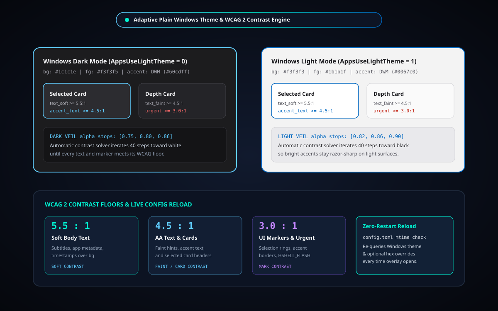

# Adaptive Plain Windows Theme & WCAG 2 Contrast

Winscroller Alt+Tab intentionally uses a **single plain Windows theme** that adapts natively to your system Light/Dark mode and Windows accent color without requiring manual theme packs.



---

## Automatic Windows Theme Query

Every time the overlay opens (`reload_config_if_changed`), Winscroller Alt+Tab queries two Windows registry settings:

1. **Light vs. Dark Mode:** `HKCU\Software\Microsoft\Windows\CurrentVersion\Themes\Personalize\AppsUseLightTheme`
   - `0` → Dark palette (`bg: #1c1c1e`, `fg: #f3f3f5`, default accent `#60cdff`, urgent `#ff6b6b`)
   - `1` → Light palette (`bg: #f3f3f3`, `fg: #1b1b1f`, default accent `#0067c0`, urgent `#c42b1c`)
2. **Windows Accent Color:** `HKCU\Software\Microsoft\Windows\DWM\AccentColor` (falling back to `ColorizationColor`)

---

## WCAG 2 Relative Luminance Contrast Solver

Inside `src/palette.rs`, `palette::derive()` computes every UI surface (veil stops, card gradients, shadows, fog, panel fills, minimap tiles, ticks, and borders) and enforces strict WCAG 2 contrast floors:

| Color Role | Minimum Ratio | Verified Surface |
| :--- | :---: | :--- |
| `text_soft` | `5.5 : 1` | Base background |
| `text_soft` (on selected card) | `4.5 : 1` | `card_selected_top` |
| `text_faint` | `4.5 : 1` | Base background |
| `accent_text` | `4.5 : 1` | Base background |
| `accent` | `3.0 : 1` | Base background |
| `urgent` (`HSHELL_FLASH`) | `3.0 : 1` | Base background |

This solver is verified by automated unit tests (`palette::tests::windows_plain_theme_meets_contrast_floors`) across both Light and Dark polarities and custom accents.

---

## Custom Color Overrides

If you want to customize any base color while preserving automatic WCAG contrast guarantees, add hex overrides (`#rgb`, `#rrggbb`, or `#aarrggbb`) to `%APPDATA%\winscroller-alt-tab\config.toml`:

```toml
[winscroller]
foreground = "#f3f3f5"
background = "#1c1c1e"
accent = "#00f5d4"
urgent = "#ff6b6b"
```
