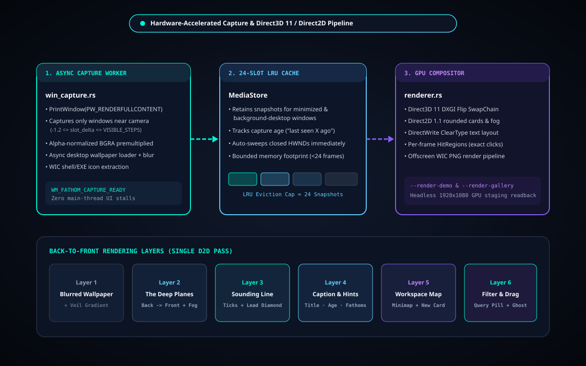

# Architecture & Internals

Winscroller Alt+Tab is structured as a single zero-dependency pure Rust crate (`windows = "0.58"`) separating deterministic platform-independent logic from native Win32/DirectX subsystems.

---

## Module Map

| Module | Layer | Responsibility |
| :--- | :--- | :--- |
| `src/depth.rs` | Core (Pure) | Logarithmic fathom depth (`log2(1 + t/30)`) and progressive fog curve (`depth * 0.08`) |
| `src/palette.rs` | Core (Pure) | Single plain Windows theme derivation & WCAG 2 relative luminance contrast solver |
| `src/config.rs` | Core (Pure) | TOML parser, strict validator (`--validate`), default generator (`--init-config`) & mtime reload |
| `src/recency.rs` | Core (Pure) | Initial Z-order seeding and live focus timestamp tracking |
| `src/field.rs` | Core (Pure) | Multi-field search filter, relative age/fathom formatting, Virtual Desktop grouping & stepping |
| `src/layout.rs` | Core (Pure) | 3D perspective stage planes, Sounding Line column grouping, minimap viewport normalization & overlap splitting |
| `src/controller.rs` | Core (Pure) | Hold/Browse state machine, `90ms` reveal timer, `15s` watchdog, `OutCubic` animations & drag-and-drop state |
| `src/win_hook.rs` | Win32 Thread | Dedicated `winscroller-kb-hook` thread running `WH_KEYBOARD_LL` + `SetWinEventHook` (`EVENT_SYSTEM_FOREGROUND`, `SHOW`, `DESTROY`) |
| `src/win_platform.rs` | Win32 / COM | Monitor & window enumeration, Virtual Desktop Registry/COM (`IVirtualDesktopManagerInternal`, `IApplicationViewCollection`), desktop creation, focus transfer & UAC elevation |
| `src/win_capture.rs` | Win32 Worker | Async `PrintWindow(PW_RENDERFULLCONTENT)` worker thread, 24-slot LRU `MediaStore`, blurred desktop wallpaper & WIC icon extraction |
| `src/renderer.rs` | DirectX GPU | Direct3D 11 DXGI swapchain, Direct2D 1.1 / DirectWrite drawing, per-frame `HitRegions` & WIC offscreen PNG staging readback |
| `src/tray.rs` | Win32 Shell | Procedural 32×32 tray icon, context menu & `HKCU\...\Run` autostart toggle |
| `src/demo.rs` | QA / Visuals | Deterministic 12-window / 8-workspace dataset for `--demo`, `--render-demo` & `--render-gallery` |
| `src/main.rs` | Entrypoint | CLI flag dispatch, single-instance mutex, Win32 `wnd_proc` event loop |

---

## Threading Model

1. **Main UI Thread (`wnd_proc`):** Runs the Win32 message loop, `Controller` state machine, Direct2D rendering, and `12ms` animation tick timer (automatically killed when idle so background CPU usage is ~0%).
2. **Keyboard Hook Thread (`winscroller-kb-hook`):** Dedicated message loop solely for `WH_KEYBOARD_LL`. Performs only O(1) atomic reads (`FATHOM_OPEN`, `FATHOM_REVEALED`, `FATHOM_HOLDING`) and asynchronous `PostMessageW` so GPU work never triggers Windows' `LowLevelHooksTimeout`.
3. **Async Capture Worker (`win_capture.rs`):** Captures window thumbnails near the camera (`-1.2 <= slot_delta <= VISIBLE_STEPS + 0.5`) and decodes blurred wallpaper off the UI thread, notifying the UI via `WM_FATHOM_CAPTURE_READY` / `WM_FATHOM_WALLPAPER_READY`.
