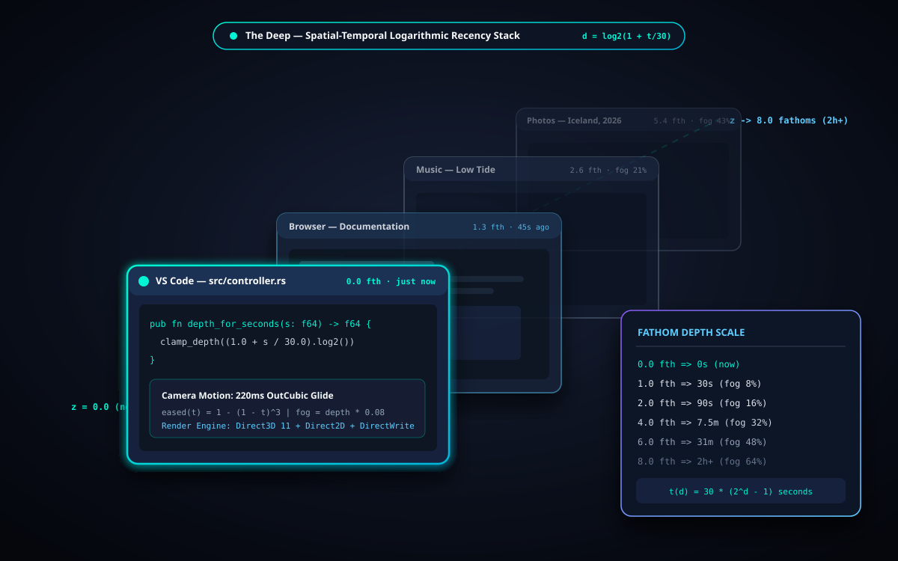

# Winscroller Alt+Tab

**A hardware-accelerated, depth-based `Alt+Tab` window switcher and Virtual Desktop workspace organizer for Windows 10/11 written in pure Rust.**

Winscroller Alt+Tab replaces Windows' flat `Alt+Tab` grid with a spatial-temporal recency plane (**The Deep**), an interactive time-travel rail (**The Sounding Line**), and a live **Workspace Map** with on-page Virtual Desktop creation and cross-desktop drag-and-drop — rendered natively with Direct3D 11, Direct2D, DirectWrite, and WIC, visually inspired by [mtolhuys/fathom](https://github.com/mtolhuys/fathom).

> 📖 **Official mdBook Documentation & Guides**:  
> [**https://fruitsaladwindowsai-zammy.github.io/Alt-Tab/**](https://fruitsaladwindowsai-zammy.github.io/Alt-Tab/)

---

## Visual Architecture Overview

---

## Highlights

- **The Deep (Spatial-Temporal Recency Stack)** — Lays out windows along a logarithmic z-axis (`depth = log2(1 + seconds / 30)` up to 8 fathoms) with smooth `220ms OutCubic` camera gliding and progressive depth fog (`0%` to `64%`).
- **The Sounding Line** — Vertical left-rail time gauge (`now` through `2h+`) plotting every window as a solid (live-tracked) or hollow (startup-estimated) clickable/draggable dot with an animated lead diamond.
- **Workspace Map & Cross-Desktop Drag-and-Drop** — Mirrors all Windows Virtual Desktops across the bottom with real minimap geometry, click-to-switch empty desktops, **`+ New desktop`** creation right on the page, and direct window drag-and-drop powered by `IApplicationViewCollection` + `IVirtualDesktopManagerInternal`.
- **Zero-Flash `90ms` Hold Reveal** — Tapping `Alt+Tab` quickly switches back to your previous window with zero visual flash; holding `Alt` past 90ms fades the overlay in smoothly (`130ms OutCubic`).
- **Instant Live Filtering** — Type immediately to filter across window titles, app names, executable IDs, and Virtual Desktop labels while keeping minimap matches lit in context.
- **Adaptive Plain Windows Theme** — Automatically matches Windows Light/Dark mode (`AppsUseLightTheme`) and Windows accent color (`DWM\AccentColor`) with WCAG 2 contrast verification (`5.5:1` / `4.5:1` / `3.0:1`).
- **Dedicated `WH_KEYBOARD_LL` Hook Thread** — O(1) non-blocking keyboard hook (`winscroller-kb-hook`) prevents hook timeouts and guarantees `Alt` never gets stuck down.

---

## Documentation Roadmap

| Guide | Description |
| :--- | :--- |
| [Getting Started](./getting-started.md) | Prerequisites (`winget`), Git clone, building, config init & launch |
| [The Deep & Sounding Line](./the-deep-and-sounding-line.md) | Logarithmic fathom math, depth fog, easing & time-rail scrubbing |
| [Keybindings & Controls](./keyboard-shortcuts.md) | Hold vs. Browse modes, keyboard chords, mouse & drag gestures |
| [Virtual Desktops & Drag-and-Drop](./virtual-desktops-and-drag-drop.md) | Workspace Map minimap, `+ New desktop` & Windows 11 COM moves |
| [Live Search & Filtering](./search-and-filtering.md) | Multi-field instant search & synchronized minimap highlighting |
| [Adaptive Theme & WCAG Contrast](./adaptive-theme-and-wcag.md) | Windows theme polarity, DWM accent & contrast solver tiers |
| [Administrator & Elevated Apps](./admin-apps-and-uipi.md) | Windows UIPI High Integrity Level elevation & `--no-elevate` |
| [Configuration Guide](./configuration.md) | Complete `config.toml` schema, clamps, hex overrides & live reload |
| [CLI Flags & System Tray](./cli-and-tray.md) | CLI flags, single-instance wake behavior & tray context menu |
| [Architecture & Internals](./architecture.md) | Module layout, async `PrintWindow` capture & D3D11/Direct2D pipeline |
