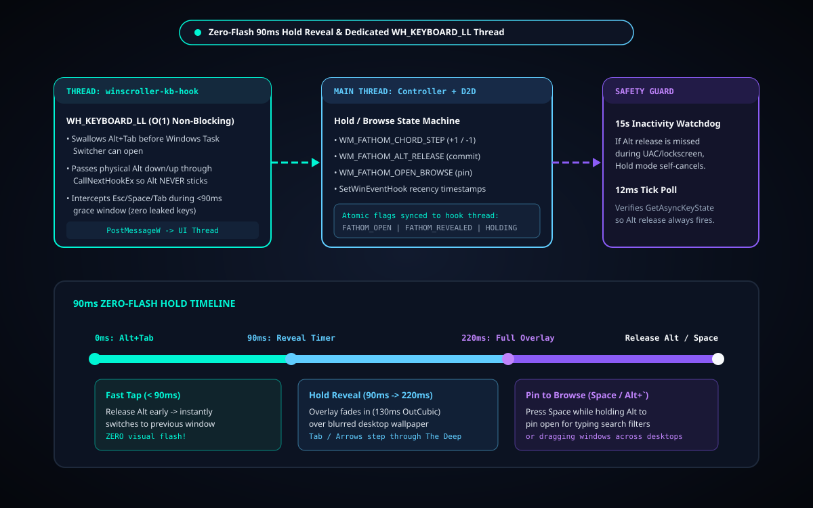

# Keybindings & Controls

Complete reference for global hotkeys, Hold vs. Browse modes, overlay navigation, filtering, Virtual Desktop controls, and mouse/drag interactions.

---

## 1. Global Shortcuts

| Shortcut | Mode | Behavior |
| :--- | :--- | :--- |
| `Alt + Tab` | Hold Mode | Swallows `Tab` before Windows' default switcher opens; targets the **previous** (`2nd` most recent) window. Additional `Tab` presses step 1 window deeper. |
| `Alt + Shift + Tab` | Hold Mode | Steps backward to the **oldest** window; subsequent `Shift + Tab` steps shallower. |
| Release `Alt` *(Hold mode)* | Hold Mode | Commits focus to the selected window and closes. Releases `< 90ms` switch immediately with **zero visual flash**. |
| `Alt + \`` *(backtick)* | Browse Toggle | Opens pinned **Browse** mode (hands-free), or closes if already open. |
| `Ctrl + Alt + Space` | Browse Toggle | Alternate Browse mode toggle. |

---

## 2. Overlay Navigation Keys

| Key | Action | Bounds / Wrapping |
| :--- | :--- | :--- |
| `Tab` / `Shift + Tab` | Step 1 window deeper / shallower | Wraps around ends |
| `↓` / `↑` | Step 1 window deeper / shallower | Clamps at ends |
| `PgDn` / `PgUp` | Jump 5 windows deeper / shallower | Clamps at ends |
| `Home` / `End` | Jump to newest / oldest visible window | Filtered order bounds |
| `→` / `←` | Jump to frontmost window of next / previous Virtual Desktop | Wraps across occupied desktops |
| `1` – `9` | Jump to frontmost window on Virtual Desktop `1`–`9` | Active when filter is empty |
| `Space` *(Hold mode, empty filter)* | Pin Hold mode into Browse mode | — |
| `Enter` | Focus selected window (switching Virtual Desktop if needed) and close | — |
| `Esc` | Clear filter if non-empty; otherwise cancel and close | — |

---

## 3. Mouse, Sounding Line & Drag-and-Drop

| Gesture | Target | Action |
| :--- | :--- | :--- |
| **Left Click** | Window plane, caption bar, or minimap tile | Focuses window and closes |
| **Left Click** | Occupied Virtual Desktop card *(outside tiles)* | Focuses frontmost window on that desktop |
| **Left Click** | Empty Virtual Desktop card | Switches Windows directly to that Virtual Desktop |
| **Left Click** | **`+ New`** / **`+ New desktop`** card | Creates a new Windows Virtual Desktop on-page |
| **Drag & Drop** *(`>= 6px`)* | Window plane or minimap tile **→** Desktop card | Moves window onto target Virtual Desktop |
| **Drag & Drop** *(`>= 6px`)* | Window plane or minimap tile **→** **`+ New desktop`** | Creates new Virtual Desktop and moves window onto it |
| **Hover** *(`>= 3px`)* | Minimap window tile | Selects window and glides The Deep camera to it |
| **Click / Drag** | Sounding Line gauge *(left rail)* | Scrubs directly to nearest depth mark |
| **Vertical Wheel** | Anywhere | Steps deeper / shallower |
| **Horizontal Wheel** | Anywhere | Steps across Virtual Desktops |
| **Left Click** | Empty background | Cancels and closes without changing focus |
