# Live Search & Filtering

When the overlay is open (either pinned in **Browse** mode via `Alt+\`` / `Ctrl+Alt+Space`, or after pinning Hold mode with `Space`), simply start typing — there is no search box to click first.

---

## Indexed Fields

Every keystroke filters your open windows live (case-insensitively) across four fields (`src/field.rs`):

1. **Window Title** — e.g. `controller.rs`, `YouTube`, `Release Notes`
2. **Human App Name** — e.g. `Code`, `Chrome`, `Terminal`, `Explorer`
3. **Executable / App ID** — e.g. `wt.exe`, `msedge.exe`, `devenv`
4. **Virtual Desktop Name / Label** — e.g. `Desktop 2`, `Work`, `Research`

---

## Filter Controls

| Input | Behavior |
| :--- | :--- |
| Printable characters (`a–z`, punctuation) | Appends to filter query and updates matches immediately |
| Digits `1`–`9` *(when filter is empty)* | Jumps straight to Virtual Desktop `1`–`9` |
| Digits `0`–`9` *(when filter is non-empty)* | Appends digit to the active search query |
| `Space` *(when filter is non-empty)* | Appends a space to the query |
| `Backspace` | Removes the last character from the query |
| `Ctrl + Backspace` | Clears the entire filter query immediately |
| `Esc` *(when filter is non-empty)* | Clears the filter without closing the overlay |
| `Enter` | Focuses the currently selected match and closes |

---

## Synchronized Visual Feedback

- **The Deep:** Reflows seamlessly to show only matching windows in recency order, gliding the camera (`220ms OutCubic`) to the newest match.
- **The Sounding Line:** Keeps matching window dots bright at their true temporal depths while dimming non-matches.
- **The Workspace Map:** Highlights matching minimap tiles in accent color across all Virtual Desktops so you immediately see which desktop owns each matching window.
