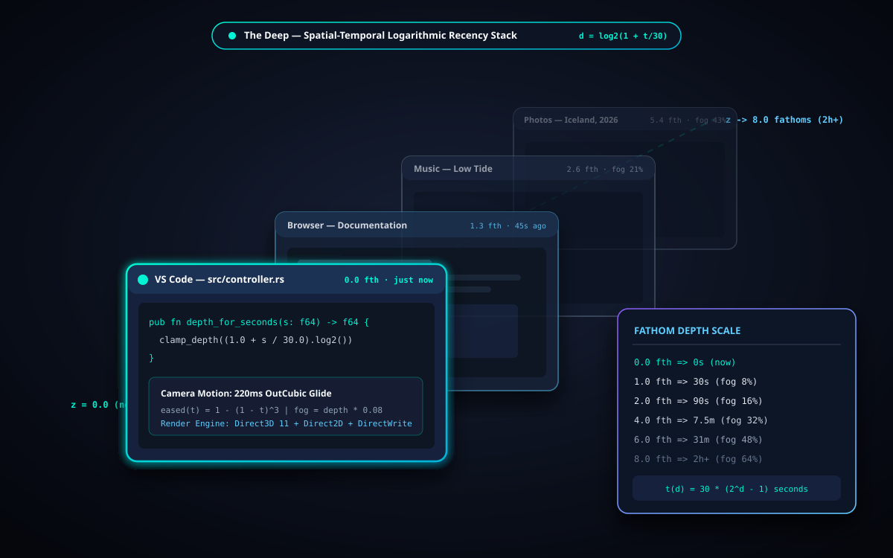
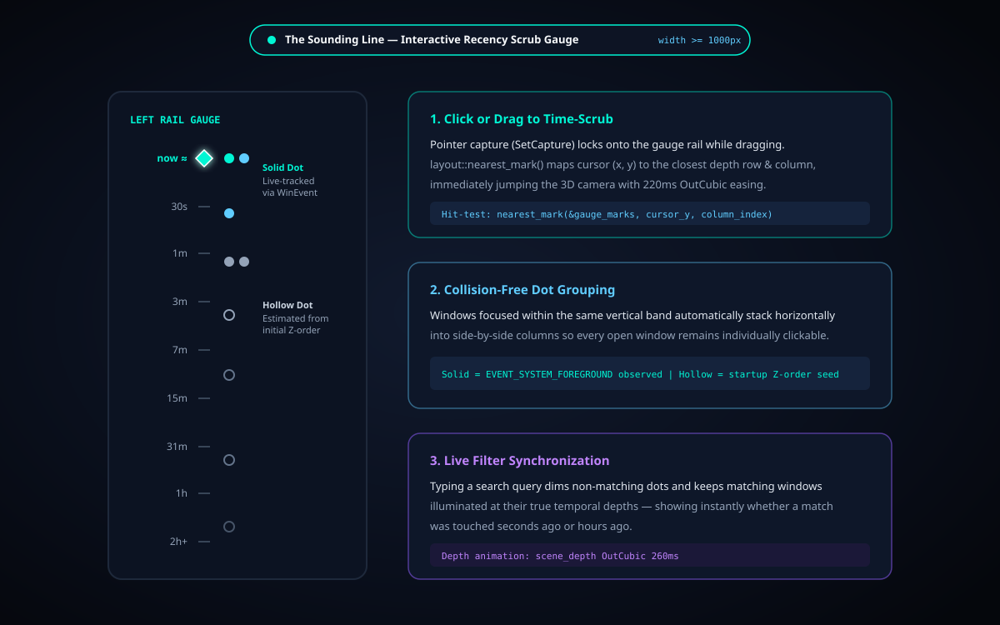

# The Deep & The Sounding Line

Winscroller Alt+Tab replaces Windows' flat `Alt+Tab` grid with a continuous **spatial-temporal model** inspired by maritime depth soundings (`fathoms`) and [mtolhuys/fathom](https://github.com/mtolhuys/fathom).

---

## The Deep — Logarithmic Depth Stack



Every open window is positioned along a logarithmic z-axis based on how many seconds have elapsed since it last held keyboard focus:

```text
depth = clamp( log2(1 + seconds_since_focus / 30), 0.0, 8.0 )
```

Conversely, a window at depth `d` fathoms lost focus `30 * (2^d - 1)` seconds ago:

| Fathom Depth | Approximate Idle Age | Progressive Fog Opacity (`depth * 0.08`) |
| :---: | :--- | :---: |
| `0.0 fth` | `0s` *(just now / active)* | `0%` |
| `1.0 fth` | `30s` | `8%` |
| `2.0 fth` | `1m 30s` | `16%` |
| `3.0 fth` | `3m 30s` | `24%` |
| `4.0 fth` | `7m 30s` | `32%` |
| `5.0 fth` | `15m 30s` | `40%` |
| `6.0 fth` | `31m 30s` | `48%` |
| `7.0 fth` | `1h 03m` | `56%` |
| `8.0 fth` | `2h 07m+` *(clamped)* | `64%` |

### Smooth Motion Curves (`src/controller.rs`)
All transitions use cubic ease-out (`OutCubic`: `1 - (1 - t)^3`) stepped on a `12ms` animation tick only while animating (zero idle CPU):
- **Camera Slot Glide:** `220ms`
- **Scene Depth Attenuation:** `260ms`
- **Overlay Reveal Fade:** `130ms`
- **Wallpaper Backdrop Fade:** `160ms`

---

## The Sounding Line — Interactive Time Gauge



On monitors at least `1000px` wide, the left rail displays **The Sounding Line**, calibrated from `now` (`≈`) down to `2h+`:

- **Solid Dots:** Windows whose focus timestamps have been observed live by `SetWinEventHook` (`EVENT_SYSTEM_FOREGROUND`).
- **Hollow Dots:** Windows present before Winscroller Alt+Tab launched, whose initial recency was estimated from Windows' Z-order stack.
- **Animated Lead Diamond:** Glides smoothly along the vertical rail to reflect the exact fathom depth of the currently selected window.
- **Collision-Free Columns:** Windows clustered at similar depths automatically arrange horizontally in side-by-side dot columns so every window remains individually clickable.
- **Click or Drag Scrubbing:** Left-click or drag anywhere along the Sounding Line (`SetCapture`) to scrub continuously across your entire window history.
