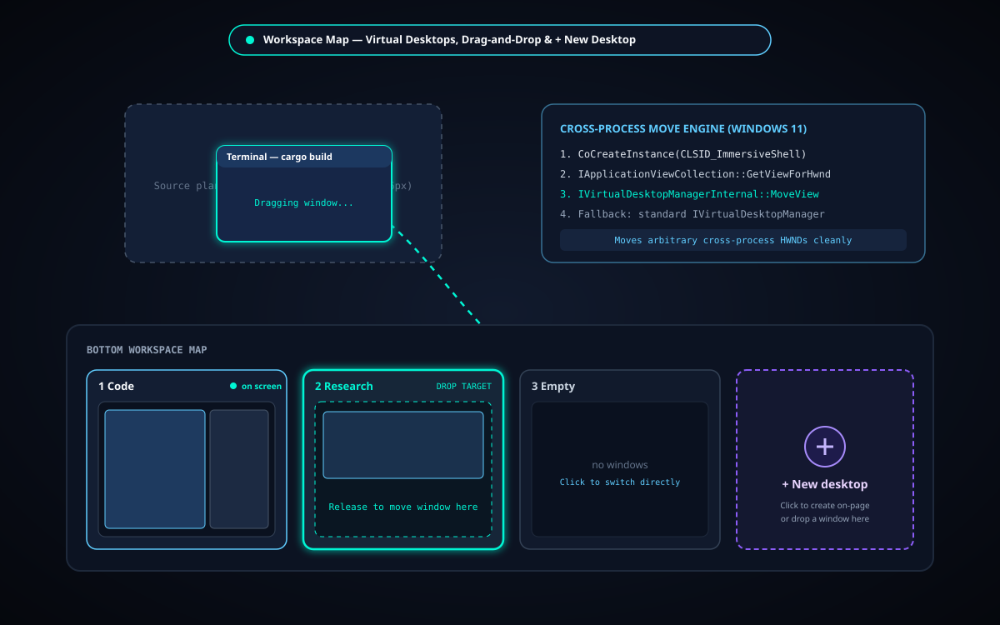

# Virtual Desktops & Drag-and-Drop

Across the bottom of the overlay, **The Workspace Map** mirrors every active Windows Virtual Desktop with live scaled window geometry, cached previews, app icons, and an `on screen` indicator.

---

## Visual Minimap Layout

- Each Virtual Desktop renders as a card displaying its desktop index (`1`, `2`, ...), custom Windows desktop name (read from the Windows Virtual Desktop registry), window count, and active `on screen` dot.
- Window rectangles inside each desktop card are proportionally normalized to monitor coordinates (`src/layout.rs`). Overlapping maximized windows are automatically split into legible side-by-side slots so no hidden window is buried underneath another.
- Hovering any minimap tile (`>= 3px` pointer movement) glides The Deep directly to that window.

---

## Creating New Virtual Desktops On-Page

Click the **`+ New desktop`** card on the right edge of the Workspace Map to spawn a new Windows Virtual Desktop without dismissing the overlay.

- Winscroller Alt+Tab suppresses transient deactivation (`900ms` guard) while orchestrating creation, reads the newly assigned desktop GUID and name, and inserts the new desktop card directly into your live session.
- You can also **drag any window directly onto `+ New desktop`** to create a fresh Virtual Desktop and move the window onto it in one single gesture.

---

## Drag-and-Drop Across Virtual Desktops

Grab any window plane in **The Deep** or any tile in **The Workspace Map** (dragging `>= 6px` transitions from click to drag) and drop it onto another Virtual Desktop card.

### How Cross-Process Moving Works (`src/win_platform.rs`)
Windows' public `IVirtualDesktopManager::MoveWindowToDesktop` API intentionally restricts moving windows owned by *other* processes. To give you full Task-View-grade drag-and-drop across all apps on Windows 11:

1. Winscroller Alt+Tab creates `CLSID_ImmersiveShell` and queries `IServiceProvider`.
2. Resolves `IApplicationViewCollection` (`GetViewForHwnd`) to obtain the window's shell `IApplicationView`.
3. Queries `IVirtualDesktopManagerInternal` (probing Windows 11 23H2 / 24H2 / 25H2+ interface IIDs) and invokes `MoveViewToDesktop`.
4. Falls back gracefully to standard `IVirtualDesktopManager::MoveWindowToDesktop` when internal interfaces are unavailable.

---

## Clicking Empty Desktops

Clicking an occupied desktop card focuses its most recently used window. Clicking an **empty** Virtual Desktop card switches Windows directly to that empty desktop and closes the overlay.
