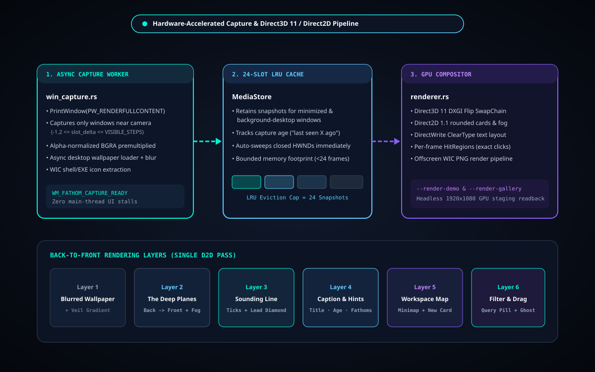

# Architecture & Internals

Winscroller Alt+Tab is a pure-Rust single-crate Windows application built on `windows = "0.58"` with zero external runtime dependencies.

---

## Core Subsystems

- **Pure Core Logic (`depth.rs`, `palette.rs`, `config.rs`, `recency.rs`, `field.rs`, `layout.rs`, `controller.rs`):** Deterministic state machine, fathom math, WCAG 2 contrast solver, TOML parser/validator, minimap geometry, and unit-tested animation curves.
- **Dedicated Keyboard Hook Thread (`win_hook.rs`):** Runs `WH_KEYBOARD_LL` on `winscroller-kb-hook` with strictly O(1) atomic checks and `PostMessageW` so GPU rendering never stalls low-level Windows hooks.
- **Async Capture Worker (`win_capture.rs`):** Off-thread `PrintWindow(PW_RENDERFULLCONTENT)` capture with a 24-slot LRU `MediaStore`, blurred desktop wallpaper loader, and WIC icon extraction.
- **GPU Compositor (`renderer.rs`):** Direct3D 11 DXGI swapchain + Direct2D 1.1 + DirectWrite rendering with per-frame hit-test geometry (`HitRegions`) and headless WIC PNG export.
- **Windows Shell & Virtual Desktop Platform (`win_platform.rs`):** Enumerates monitors/windows, tracks Windows Virtual Desktops via Registry/COM, creates desktops on-page, and moves cross-process windows via `IApplicationViewCollection` + `IVirtualDesktopManagerInternal`.
