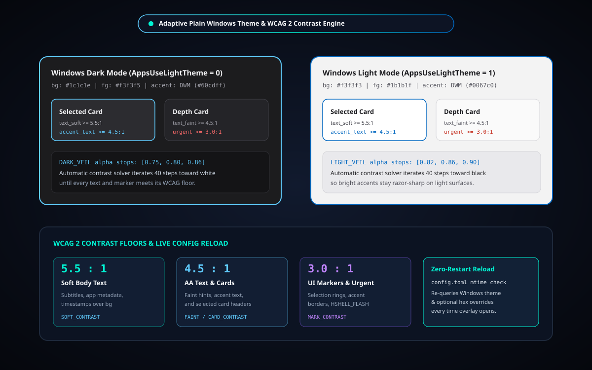

# Configuration Guide

Settings live in `%APPDATA%\winscroller-alt-tab\config.toml` and reload **live** the next time the overlay opens.



---

## Initialize & Validate

```powershell
.\target\release\winscroller-alt-tab.exe --init-config
.\target\release\winscroller-alt-tab.exe --validate
```

Or right-click the tray icon and select **Open config.toml**.

---

## Schema Reference (`[winscroller]` or `[fathom]`)

| Key | Type | Default | Valid Range / Format | Description |
| :--- | :--- | :--- | :--- | :--- |
| `corner-radius` | float | `10.0` | `>= 0.0` | Card & pill corner radius (px) |
| `border-width` | float | `1.0` | `>= 0.0` | Card border stroke width (px) |
| `font-family` | string | `"Segoe UI"` | Installed font name | DirectWrite font family |
| `font-scale` | float | `1.0` | `> 0.0`, clamped `[0.7, 2.0]` | Global text scale multiplier |
| `show-scratchpads` | bool | `true` | `true` \| `false` | Show special/scratchpad workspaces |
| `open-on-single` | bool | `false` | `true` \| `false` | Allow Hold mode (`Alt+Tab`) with 1 window |
| `foreground` | hex | *(Windows auto)* | `#rgb`, `#rrggbb`, `#aarrggbb` | Optional foreground override |
| `background` | hex | *(Windows auto)* | `#rgb`, `#rrggbb`, `#aarrggbb` | Optional background override |
| `accent` | hex | *(Windows DWM)* | `#rgb`, `#rrggbb`, `#aarrggbb` | Optional accent override |
| `urgent` | hex | *(Windows auto)* | `#rgb`, `#rrggbb`, `#aarrggbb` | Optional flashing/urgent color override |

All derived colors automatically satisfy WCAG 2 contrast floors (`5.5:1` soft text, `4.5:1` faint text & selected card headers, `3.0:1` accents & urgent indicators).
