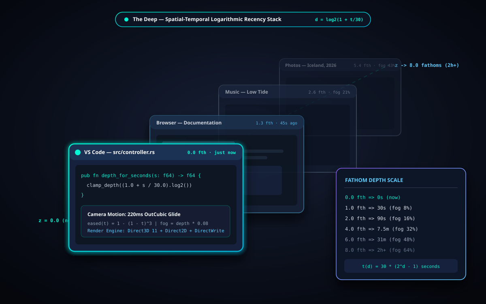
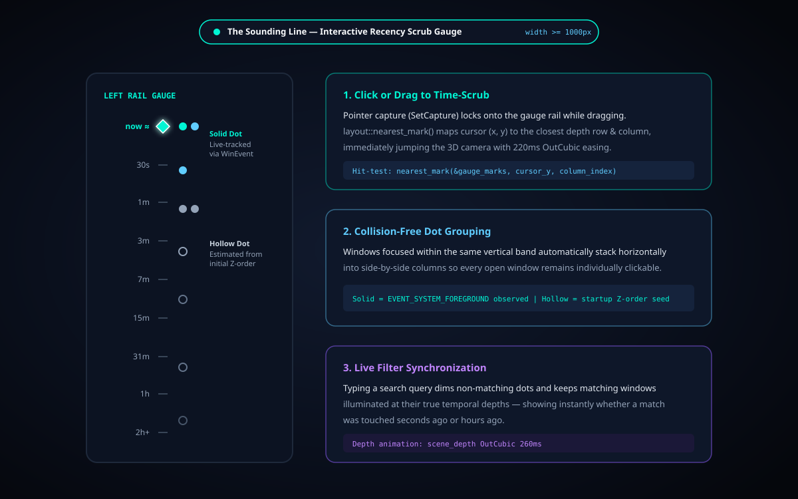
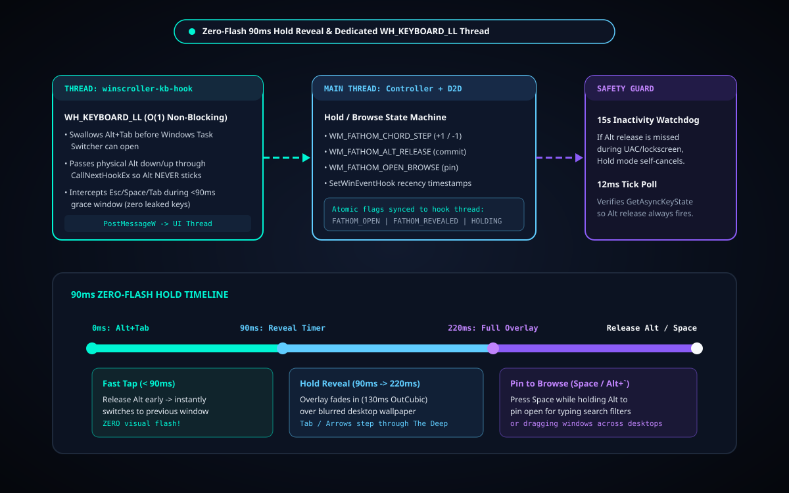

# Core Concepts

Winscroller Alt+Tab combines three synchronized visual views: **The Deep**, **The Sounding Line**, and **The Workspace Map**.



---

## Logarithmic Fathom Depth (`src/depth.rs`)

Instead of showing every window at equal visual weight, each window sits at a depth measured in **fathoms**:

```text
depth = clamp( log2(1 + seconds_since_focus / 30), 0.0, 8.0 )
fog   = depth * 0.08
```

- `0.0 fathoms` → `just now` (`0%` fog)
- `1.0 fathom` → `30s ago` (`8%` fog)
- `2.0 fathoms` → `1m 30s ago` (`16%` fog)
- `4.0 fathoms` → `7m 30s ago` (`32%` fog)
- `8.0 fathoms` → `2h+ ago` (`64%` fog)

---

## The Sounding Line



Shown along the left rail whenever monitor width is `>= 1000px`:
- **Solid dots** represent windows whose focus time was observed live via `SetWinEventHook`.
- **Hollow dots** represent windows seeded from initial Z-order at launch.
- **Click or drag** anywhere on the rail to scrub continuously through your window history.

---

## Zero-Flash `90ms` Hold Reveal



- Releasing `Alt` within `90ms` switches directly to the previous window with **zero overlay flash**.
- Holding `Alt` past `90ms` fades in the full overlay (`130ms OutCubic`).
- Pressing `Space` (with an empty filter) pins Hold mode into Browse mode so releasing `Alt` keeps the overlay open.
