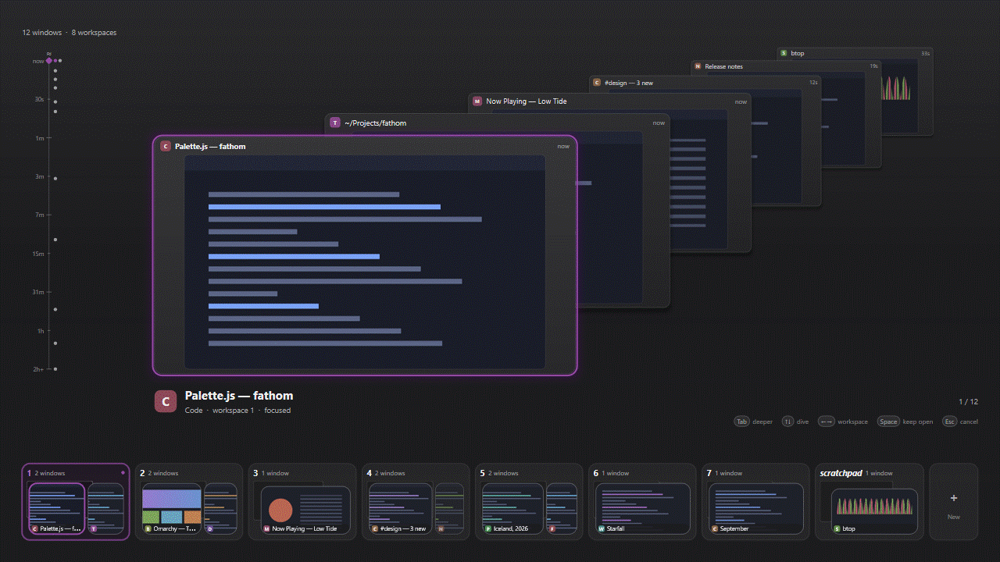

# Welcome to the Winscroller Alt+Tab Wiki

**Winscroller Alt+Tab** is a hardware-accelerated, spatial-temporal `Alt+Tab` window switcher and Virtual Desktop organizer for Windows 10 and 11, written in pure Rust with Direct3D 11, Direct2D, DirectWrite, WIC, and Win32, visually inspired by [mtolhuys/fathom](https://github.com/mtolhuys/fathom).

---

## 🧭 Navigation & Guides

| Category | Pages |
| :--- | :--- |
| 🚀 **Getting Started** | • [[Getting Started\|Getting-Started]] • [[Core Concepts\|Core-Concepts]] • [[Keyboard Shortcuts\|Keyboard-Shortcuts]] |
| 🪟 **Workspaces & Search** | • [[Virtual Desktops & Drag-and-Drop\|Virtual-Desktops-and-Drag-Drop]] • [[Live Search & Filtering\|Live-Search-and-Filtering]] |
| 🛡️ **System & Controls** | • [[Administrator & Elevated Apps\|Administrator-and-Elevated-Apps]] • [[CLI Flags & Tray Controls\|CLI-Flags-and-Tray-Controls]] |
| ⚙️ **Customization & Internals** | • [[Configuration Guide\|Configuration-Guide]] • [[Architecture & Internals\|Architecture-and-Internals]] • [[Troubleshooting & FAQ\|Troubleshooting-and-FAQ]] |

---

## 🌟 Key Highlights

1. **The Deep — Spatial-Temporal Recency Stack**:  
   Windows recede along a logarithmic z-axis (`depth = log2(1 + seconds / 30)` up to 8 fathoms) with smooth `220ms OutCubic` camera gliding and exponential fog (`0%` to `64%`).
2. **The Sounding Line — Interactive Time Gauge**:  
   Left-rail time scale (`now` through `2h+`) plotting every window as a clickable/draggable dot (solid for live-tracked focus, hollow for startup-estimated Z-order) with an animated lead diamond.
3. **Workspace Map, `+ New desktop` & Cross-Desktop Drag-and-Drop**:  
   Mirrors every Windows Virtual Desktop across the bottom with real minimap geometry, spawns new Virtual Desktops on the page, and moves cross-process windows via Windows 11 shell COM (`IApplicationViewCollection` + `IVirtualDesktopManagerInternal`).
4. **Zero-Flash `90ms` Hold Reveal & Dedicated Hook Thread**:  
   Tapping `Alt+Tab` under 90ms switches silently with zero flash. A dedicated `WH_KEYBOARD_LL` thread (`winscroller-kb-hook`) keeps hooks O(1) and guarantees `Alt` never sticks.
5. **Adaptive Plain Windows Theme & WCAG 2 Contrast**:  
   Automatically reads Windows Light/Dark mode (`AppsUseLightTheme`) and Windows accent color (`DWM\AccentColor`) with guaranteed `5.5:1` / `4.5:1` / `3.0:1` contrast floors and live TOML reload.
