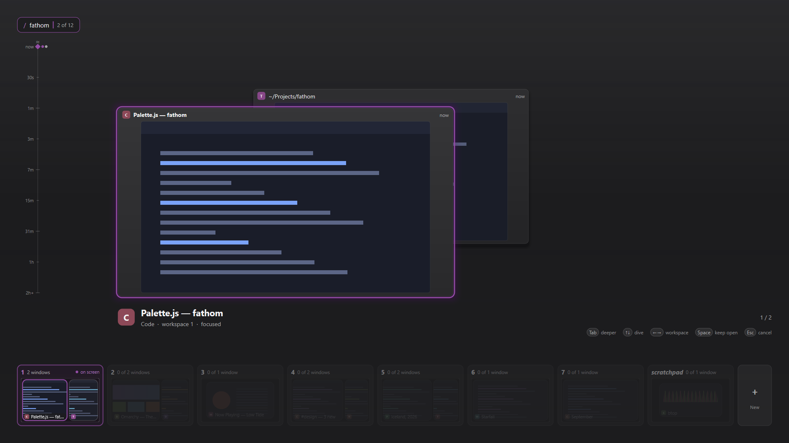

# Live Search & Filtering

Start typing anytime while Winscroller Alt+Tab is open to filter windows instantaneously across titles, app names, executable IDs, and Virtual Desktop labels.

---

## Filter Controls

| Input | Action |
| :--- | :--- |
| Letters / punctuation | Appends to case-insensitive search query |
| `1`–`9` *(when filter empty)* | Jumps directly to Virtual Desktop `1`–`9` |
| `0`–`9` *(when filter active)* | Appends digit to the filter query |
| `Space` *(when filter active)* | Appends a space to the filter query |
| `Backspace` | Removes last character |
| `Ctrl + Backspace` | Clears entire filter query |
| `Esc` *(when filter active)* | Clears filter without closing overlay |
| `Enter` | Focuses selected match and closes |
