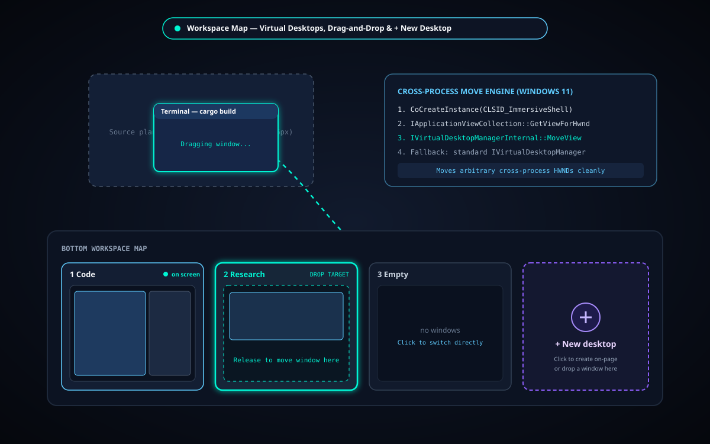
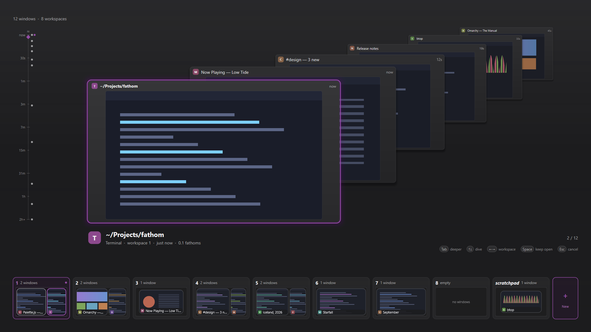
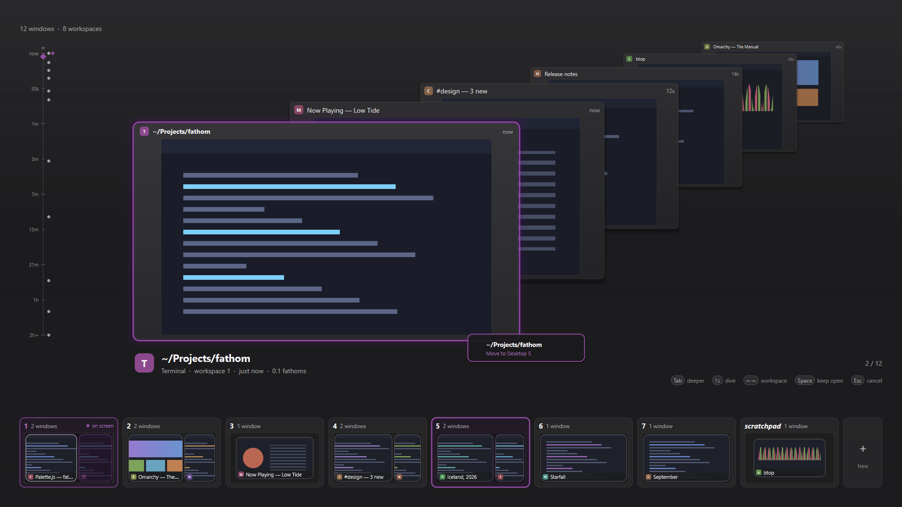

# Virtual Desktops & Drag-and-Drop

**The Workspace Map** across the bottom of Winscroller Alt+Tab mirrors every Windows Virtual Desktop with live scaled window geometry, cached previews, app icons, and an `on screen` indicator.

---

## Creating Desktops Directly On-Page

Click the **`+ New desktop`** card at the right edge of the Workspace Map to spawn a fresh Windows Virtual Desktop without leaving the overlay.

- You can also drag any window card directly onto **`+ New desktop`** to create a new desktop and transfer that window onto it in one single drag.

---

## Drag-and-Drop Across Virtual Desktops

1. Click and drag (`>= 6px`) any window card in **The Deep** or any minimap tile in **The Workspace Map**.
2. Hover over another Virtual Desktop card (or **`+ New desktop`**).
3. Release to move the window natively via Windows 11's internal shell COM interfaces (`IApplicationViewCollection` + `IVirtualDesktopManagerInternal`, falling back cleanly to `IVirtualDesktopManager`).

---

## Empty Desktop Click-to-Switch

Clicking any empty Virtual Desktop card switches Windows directly to that empty desktop and dismisses the overlay.
